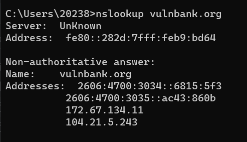
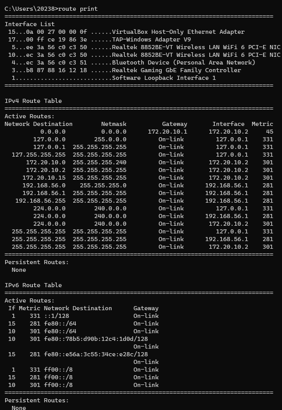
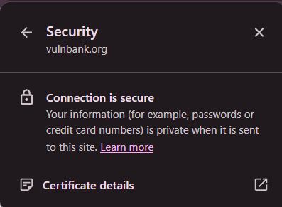
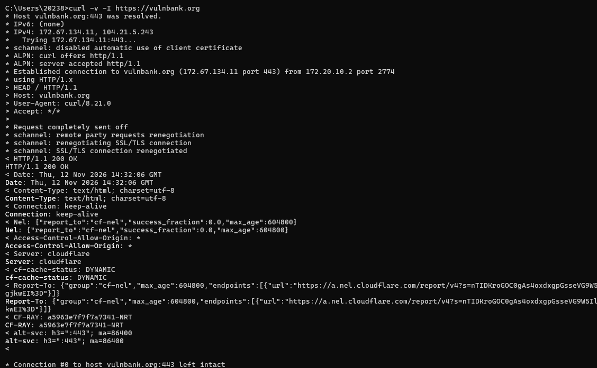
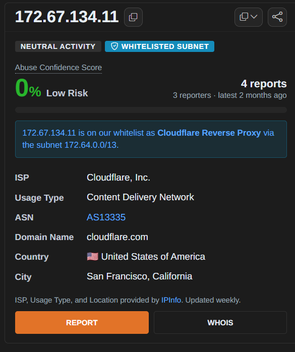
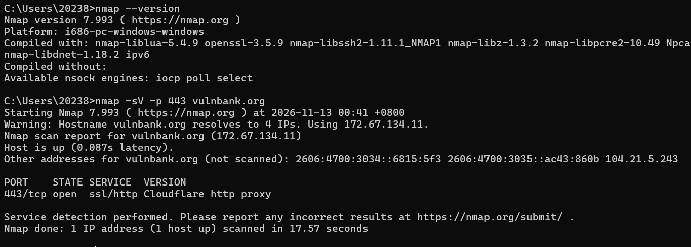

# Week 5 – Active Footprinting

## Lab 4

**Target:** VulnBank

**Objective:**

The objective of this lab is to perform active reconnaissance on an authorized vulnerable web application environment. The activity focuses on identifying hosts, discovering open ports and detecting running services using Nmap.

## Lab Sections
1. Lab Setup
2. Own Host and Discovered Hosts
3. Services and Interpretation
4. Limitations and Risks

## Part 1: Lab Setup

| Item | Details |
|---|---|
| Target Name | VulnBank |
| Target URL | https://vulnbank.org/ |
| Application Type | Banking Web Application |
| Target Category | Intentionally Vulnerable Web Application |
| Purpose | Application Security Testing |

**Source:** https://vulnbank.org/

## Part 2: Own Host & Discovered Hosts

### IP Address Discovery

The DNS lookup was performed using the `nslookup` command. The result returned two IPv4 addresses and two IPv6 addresses for the VulnBank domain.

- IPv4: 172.67.134.11
- IPv4: 104.21.5.243

Figure 2: DNS lookup result using nslookup.

### 2.3 Routing Table

The `route print` command was used to view the routing table on the Windows host. The output shows the active network interfaces, default gateway and connected network routes.

- Wi-Fi Network: 172.20.10.0/28
- Default Gateway: 172.20.10.1
- VirtualBox Host-Only Network: 192.168.56.0/24

Figure 3: Windows routing table using route print.

## Part 3: Services & Interpretation
### 3.1 Lab Target Port

- Target: VulnBank
- Domain: vulnbank.org
- Web Protocol: HTTPS
- Standard Port: 443

Note: Port 443 is the standard HTTPS port. Its availability on the target server was not independently verified through port scanning.

Figure 4: HTTPS connection information for VulnBank.
### 3.2 TCP Service Information

The `curl -v -I` command was used to examine the HTTPS connection to VulnBank.

**Observation:**
- Destination Port: TCP 443
- Service: HTTPS
- HTTP Version: HTTP/1.1
- HTTP Status: 200 OK
- Server: Cloudflare

**Interpretation:**

The output confirms that a TCP connection to port 443 was successfully established. The server returned an HTTP 200 OK response, indicating that the request was successfully processed.

**Limitation:**

This test only confirms the HTTPS connection. It does not identify all open TCP ports or se

Figure 5: HTTPS connection test using curl.
### 3.3 IP Reputation Analysis

The IP address `172.67.134.11` was checked using AbuseIPDB.

**Observation:**
- IP Address: 172.67.134.11
- Abuse Confidence Score: 0%
- ISP: Cloudflare, Inc.
- Usage Type: Content Delivery Network (CDN)
- ASN: AS13335
- Country: United States

**Interpretation:**

The IP address has an Abuse Confidence Score of 0%, indicating that AbuseIPDB has no abuse reports contributing to its confidence score. The IP belongs to Cloudflare and is identified as a Content Delivery Network (CDN).

**Source:** [AbuseIPDB](https://www.abuseipdb.com/check/172.67.134.11)

Figure 6: IP reputation check using AbuseIPDB.

### 3.4 Nmap Service Detection

The Nmap command `nmap -sV -p 443 vulnbank.org` was used to identify the service running on TCP port 443.

**Observation:**
- Target IP: 172.67.134.11
- Host Status: Up
- Port: 443/tcp
- State: Open
- Service: ssl/http
- Version: Cloudflare http proxy

**Interpretation:**

The scan shows that TCP port 443 is open and provides an HTTPS web service through Cloudflare's proxy. This confirms that the target IP is reachable through the HTTPS service.

**Limitation:**

The scan only examined port 443 on one of the four IP addresses returned by DNS. The result identifies Cloudflare's proxy service and does not confirm the actual services or versions running on VulnBank's origin server.

Figure 7: Nmap service detection result for VulnBank.

## Part 4: Limitations and Risks

### 4.1 Limitations
The activity was limited to DNS lookup, routing table inspection and HTTPS connection testing. No active Nmap scanning was performed because permission to scan the public VulnBank server was not provided. Therefore, the complete list of open ports and running services could not be identified.
### 4.2 Risks

Active scanning of public systems without permission may cause unwanted network traffic, trigger security alerts or affect system availability. Therefore, testing was limited to basic information gathering and normal HTTPS access.
## Conclusion

This activity provided an understanding of basic network information gathering using DNS lookup, routing table inspection and HTTPS connection testing. The results helped identify the website's IP addresses, network routes and HTTPS service information while maintaining the testing limitations.

